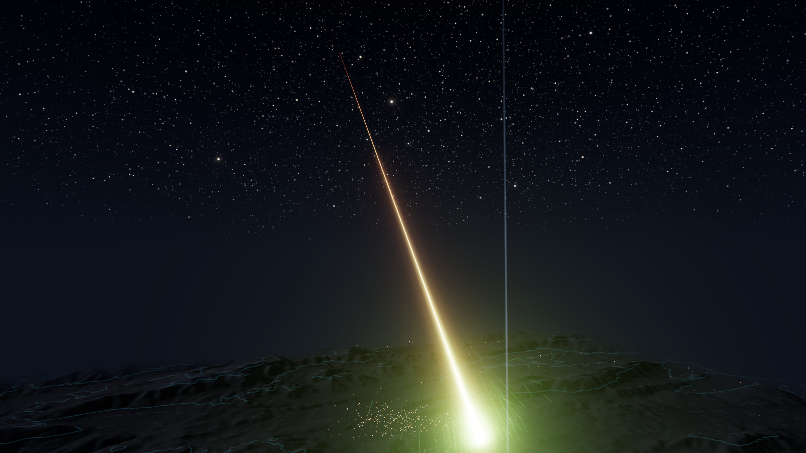
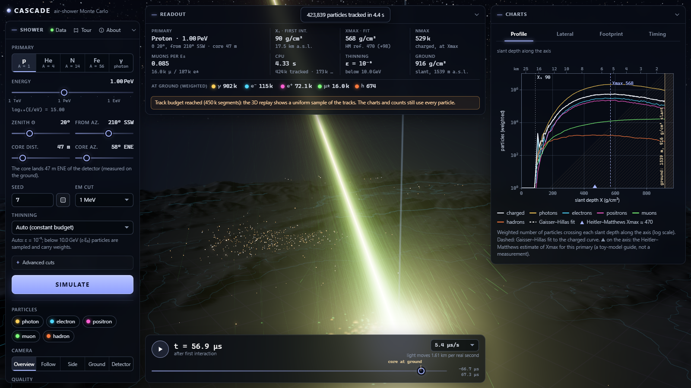
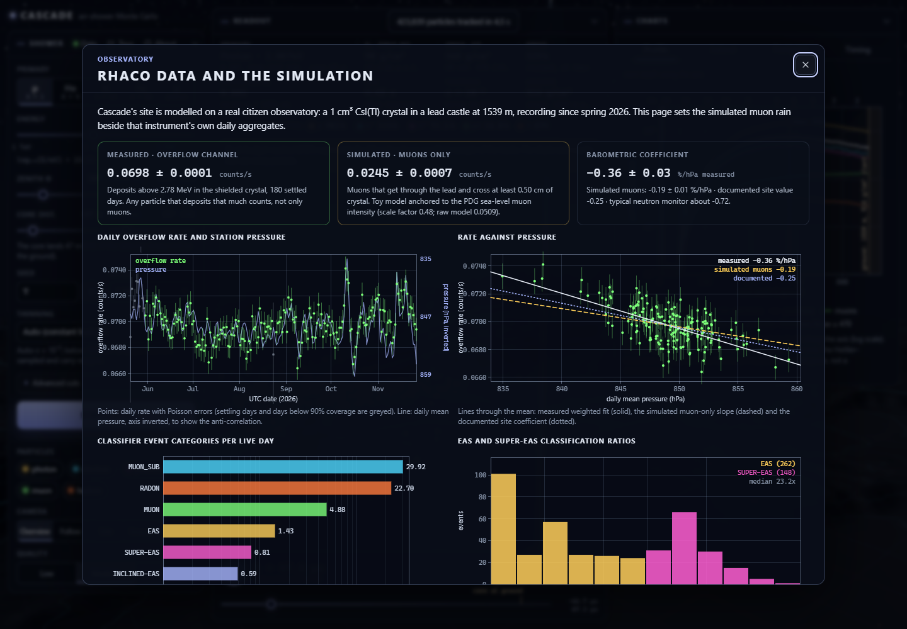

# Cascade

**A cosmic-ray air shower, simulated particle by particle in your browser and replayed in 3D over the Nevada high desert.**



Live: **https://highsierralabs.github.io/End_of_week_challenge/** · Validation: [validation.html](https://highsierralabs.github.io/End_of_week_challenge/validation.html)

Cascade follows a primary cosmic ray (a proton, a helium, nitrogen or iron nucleus, or a gamma ray, from 1 TeV to
10 EeV) from its first collision 15-25 km up, through the hadronic core, the decays of pions into photons and muons,
and the electromagnetic cascade, down to the ground at 1539 m. Hundreds of thousands of particles are tracked in a Web
Worker in a few seconds. The shower is then replayed at a slow-motion factor you choose: the front sweeps down at
the speed of light, the muons arrive first, and the ground lights up where particles land.

The site is modelled on a real place. The ground is 60 km of real terrain around Stead, north of Reno (USGS 3DEP,
via the AWS Terrain Tiles). The detector is drawn to scale: a 1 cm³ CsI(Tl) crystal in a lead castle like the one the
**RHACO** citizen cosmic-ray observatory runs there. A **Data** panel sets Cascade's prediction for that crystal beside
the observatory's own measurements.

## What you can do

- **Simulate** any primary at any energy, zenith and azimuth, and land the core where you like relative to the detector.
- **Replay** in 3D with five camera presets (overview, follow the front, side, ground, detector), per-species
  toggles (photons, electrons, positrons, muons, hadrons) and a scrubbable shower clock. Press **H** to hide the interface.
- **Read the shower** in four live charts:
  - the longitudinal profile, with a Gaisser-Hillas fit and the Heitler-Matthews reference;
  - the lateral distribution against the NKG function;
  - the ground footprint;
  - arrival times relative to a plane front.
- **Take the guided tour**: twelve steps through air-shower physics, each running its own shower.
- **Compare with a real instrument**: the rate mode simulates the steady rain of muons at the site and predicts the
  count rate and barometric coefficient of the observatory's crystal. The Data panel puts those next to 180 days of
  measured daily rates and pressures, with the honest-scope caveats a real measurement deserves.
- **Check the physics**: the validation page compares the depth of shower maximum, its spread, the shower size and the
  muon number with standard scalings and published full-simulation values.



## The physics, briefly

The atmosphere is Linsley's parameterisation of the US Standard Atmosphere, as used by CORSIKA.

- **Hadrons** follow a calibrated toy model: energy-dependent cross sections, a leading particle, and pions with
  realistic multiplicity and transverse momentum. Nuclei use semi-superposition.
- **Decays** use exact two-body kinematics; muons decay with the Michel spectrum.
- **The electromagnetic cascade** has Bethe-Heitler bremsstrahlung and pair production, Klein-Nishina Compton
  scattering, ionisation and multiple scattering.
- **Hillas thinning** keeps any energy interactive.

The full model, its approximations and its limits are in [docs/physics.md](docs/physics.md).

How close does a toy get? After calibrating two parameters, the mean depth of shower maximum from the validation
ensemble (24 showers each) is:

| Primary at 1 PeV | Simulated Xmax | Expected (accelerator-tuned models) |
|---|---|---|
| Proton | 571 ± 12 g/cm² | 540-575 g/cm² |
| Iron | 474 ± 5 g/cm² | 440-470 g/cm² |

The ranges are approximate published full-simulation values. Photon showers reach 91-97% of Greisen's size at
maximum, and the muon number grows as E^0.92, at the top of the 0.85-0.93 reference range. The model also misses in
places: proton Xmax sits 13-35 g/cm² above the reference band at 3 of 5 energies, the iron elongation rate is about
5 g/cm² per decade low, and the Xmax spread drifts away from the full simulations at the extremes. The
[validation page](validation.html) scores every one of these.

## Cascade and the RHACO observatory



The observatory's "overflow" channel counts every deposit above 2.78 MeV in its shielded crystal. That does not
make it a muon counter: the instrument defines the category. Cascade's rate mode predicts the muon part:

- muons that survive the lead;
- crossing enough crystal to deposit that much;
- anchored to the PDG sea-level muon intensity.

| Quantity | Measured | Simulated, muons only |
|---|---|---|
| Rate | 0.0698 counts/s | 0.025 counts/s |
| Barometric coefficient | -0.36 %/hPa | -0.19 %/hPa |

Both comparisons point to a substantial non-muon component in the channel.

A second estimate asks how often a shower core lands close enough to put several particles through a 1 cm² crystal
at once. Folding simulated near-core densities from 10¹⁴ to 10¹⁸ eV with the cosmic-ray flux gives tens of times a
year at most. The classifier's EAS categories fire about 2 times a day. Whatever those count-rate patterns are, they
are not mostly multi-particle shower cores, which is consistent with the observatory's own rule that the classifier
labels categories, not physics. The Data panel works through the
estimates, why they differ, and what measurement would settle it. The aggregate snapshot and its provenance are
described in [docs/rhaco_snapshot.md](docs/rhaco_snapshot.md).

## Run it locally

Node 24.14.1 or later (below 25):

```bash
cd Cascade
npm ci
npm run dev          # http://127.0.0.1:5190
npm run check        # typecheck + lint + physics unit tests
npm run build        # static site in dist/
```

Other commands:

```bash
npx vite-node scripts/precompute-rate.ts -- site 240000 2026   # regenerate the rate-mode data
npx vite-node scripts/precompute-validation.ts                 # regenerate the validation data
node scripts/shot.mjs --url "/?clean" --out shots/x.png        # screenshot (needs the dev server)
```

URL options:

| Option | Effect |
|---|---|
| `?webgl` | Force the WebGL2 backend |
| `?quality=low\|medium\|high` | Set the quality level |
| `?seed=N` | Set the random seed |
| `?clean` | Start with the interface hidden |
| `?data` | Open the Data panel |

## Layout

| Path | What |
|---|---|
| `src/physics/` | The Monte Carlo: pure, deterministic TypeScript (atmosphere, cross sections, cascade, rate mode, fits). |
| `src/sim/` | The worker and its client. |
| `src/render/` | three.js WebGPU renderer, TSL shaders: track replay, terrain, sky, detector, camera rig. |
| `src/ui/` | Panels, charts, tour, the Data panel. |
| `src/data/` | The RHACO aggregate snapshot and the precomputed rate and validation runs. |
| `scripts/` | DEM fetch, snapshot generator, precompute scripts, screenshots. |
| `tests/unit/` | Physics tests. |

## Credits

- Inspired by and compared against the RHACO citizen cosmic-ray observatory, Stead, Nevada. The scene origin is an
  illustrative point on the valley floor, not the observatory's location.
- Terrain: Terrain Tiles on AWS Open Data (Mapzen / Linux Foundation), from USGS 3DEP and other sources.
- Rendering: [three.js](https://threejs.org) (WebGPU, with a WebGL2 fallback).
- Physics references: Gaisser, Engel & Resconi; Matthews (2005); Kampert & Unger (2012); the PDG reviews; CORSIKA; EGS4.
- Built with [Claude Code](https://claude.com/claude-code) (Claude Opus 5.5) as an end-of-week challenge.

MIT licence: see [LICENSE](../LICENSE). Third-party notices: [THIRD-PARTY-NOTICES.md](../THIRD-PARTY-NOTICES.md).
