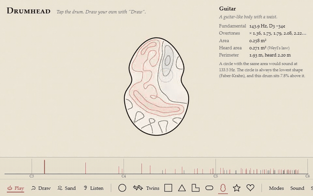
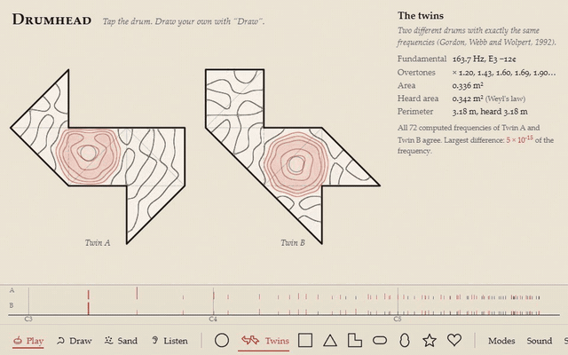
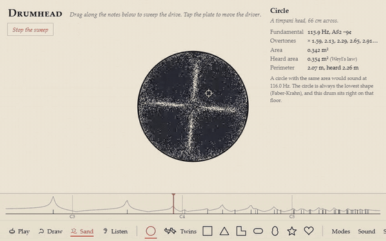
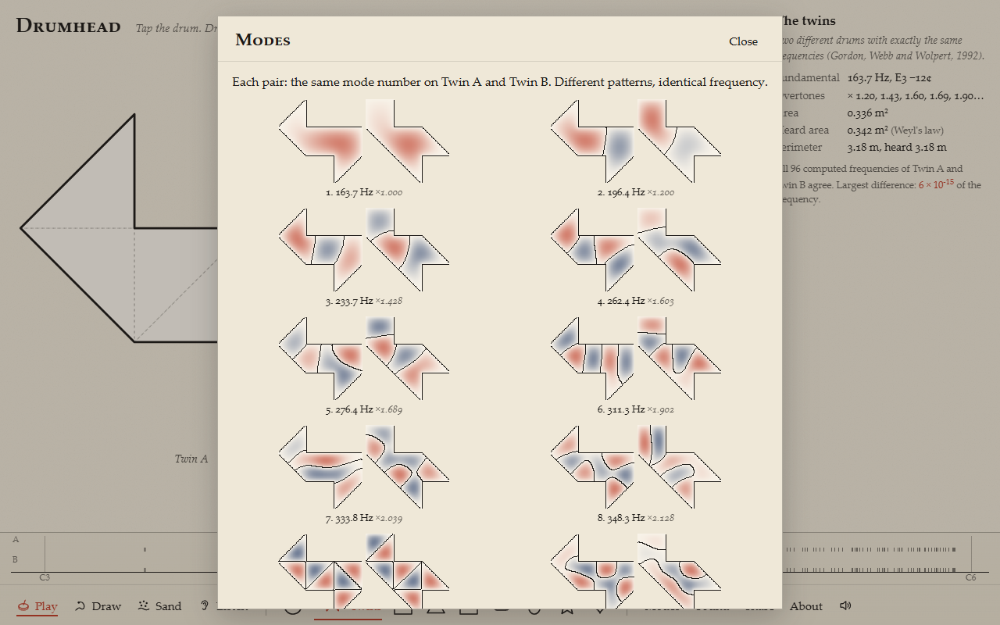
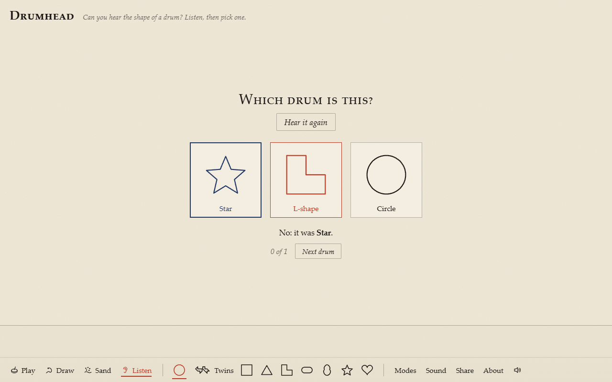
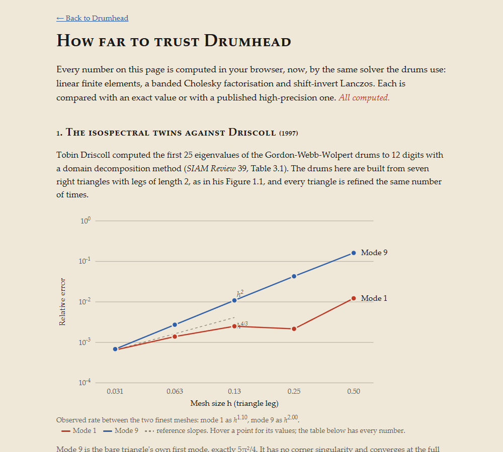

# Drumhead

**Draw any shape and play it as a drum. Its vibration modes are solved in your browser, sand finds the still lines,
and two different drums sound exactly alike.**



Live: **https://highsierralabs.github.io/End_of_week_challenge/drumhead/** · Validation: [validation.html](https://highsierralabs.github.io/End_of_week_challenge/drumhead/validation.html)

In 1966 Mark Kac asked: *can one hear the shape of a drum?* If you knew every frequency a drumhead can make, could
you work out its shape? Drumhead lets you test that with your hands and ears. Draw a shape, or pick one, and the page
works out how that membrane can vibrate: its lowest 96 modes, each with its own pitch and its own pattern of hills,
valleys and still lines. Then tap it. Each tap excites every mode by how much the membrane moves at the spot you
tapped, and you hear the sum.

## What you can do

- **Play.** Tap the drum, anywhere. Centre, edge and nodal lines sound different. Drag across it for a roll. The
  picture is the vibration itself, slowed down a hundredfold or more: vermilion is up, Prussian blue is down, and the
  black lines are where the membrane is still.
- **Draw.** Draw any closed shape in one stroke and it becomes a drum, meshed and solved in about a second on a desktop. The
  table is one metre across, so a bigger drawing really is a lower drum. **Share** puts your drum's outline in the
  link.
- **Sand.** The drum becomes a plate under a dusting of sand, driven at one frequency from a point you choose. Off
  resonance the sand barely stirs. On resonance it runs into the mode's nodal lines and draws it, as in Ernst Chladni's
  1787 experiments. *Sweep through the modes* glides from one figure to the next.
- **The twins.** Two drums of different shapes, from Gordon, Webb and Wolpert's 1992 answer to Kac: *no*. They have
  the same frequencies. Drumhead computes each twin separately, and their 96 frequencies agree to about 6 parts in
  10<sup>15</sup>, which is rounding error. The **Modes** view shows the same pitch arising from different patterns.
- **Listen.** A hidden drum is struck and you pick its shape from three. Sometimes two of the three are the twins,
  and then either answer counts, because nobody could tell them apart.
- **Read the card.** For every drum the card gives the fundamental and its note, the overtone ratios, and the area and
  perimeter as *heard* from the frequencies through Weyl's law, next to the true values. It also shows how far the
  fundamental sits above that of a circle with the same area, which by the Faber-Krahn inequality is the lowest
  possible.









## How it works

1. **Meshing.** A freehand shape is filled with an equilateral lattice of about 2,600 vertices, and the lattice points
   on the rim are snapped onto your line. Presets with straight sides (square, triangle, L-shape, the twins) are cut
   into a few large triangles and refined evenly.
2. **The equations.** The membrane obeys −∇²u = λu inside, with u = 0 on the rim. Linear finite elements turn that
   into the matrix problem K x = λ M x, with K the stiffness and M the (lumped) mass.
3. **The solver.** The lowest modes come from Lanczos iteration on K⁻¹ (shift-invert, with full
   reorthogonalisation). K is reordered by reverse Cuthill-McKee and factored once as a band matrix. All of this runs
   in a Web Worker. In headless Chromium on the desktop it was built on, 96 modes took 1.2 s for the circle and
   1.6-1.7 s for each twin (the two solve in parallel).
4. **Sound.** This is modal synthesis in an AudioWorklet: one decaying sine per mode, at f = c√λ / 2π, where c is the
   membrane's wave speed (the Pitch slider). A strike starts each mode with the mode's height at the strike point,
   rolled off by the mallet (soft felt to hard stick). A few milliseconds of filtered noise add the contact click.
   Higher modes decay faster, and a quiet synthetic room is mixed in.
5. **Picture.** The same modes run slowed down so that the fundamental shows at about 0.8 Hz. Each is weighted by
   f₁/f, because a strike sets each mode's velocity and its displacement is that velocity over its frequency. WebGL2
   draws the washes, contours and nodal lines.
6. **Sand.** The steady response to a drive at frequency f is Σₖ φₖ(x₀) φₖ(x) / (fₖ² − f² + i g f fₖ). Each grain
   hops by an amount proportional to the local amplitude, so the grains drain out of the moving regions and collect
   where the plate stands still.
7. **Hearing the shape.** Weyl's law with the perimeter term, N(λ) ≈ Aλ/4π − P√λ/4π + 1/6, is fitted to the first
   48 eigenvalues to estimate A and P.

## How far to trust it

The [validation page](https://highsierralabs.github.io/End_of_week_challenge/drumhead/validation.html) reruns all of
this in the visitor's browser. The figures below are from one run of it on 27 November 2026.

| Check | Result |
|---|---|
| GWW twins vs Driscoll (1997), 25 eigenvalues, 5 refinements (the app's level, 3,729 vertices) | largest error 0.73% |
| Same, 6 refinements (14,625 vertices) | largest error 0.18%; mode 1 0.065% |
| Twin A vs Twin B, 25 eigenvalues, every refinement from 2 to 6 | agree to 1.4 × 10⁻¹⁴ or better |
| Unit square, first 10 modes vs π²(m² + n²), 4,225 vertices | within 0.31% |
| Unit disc, first 6 modes vs Bessel zeros, lattice mesh, 5,995 vertices | within 0.15% |
| Weyl's law on the 10 presets: heard area, heard perimeter | area within 4.4%, perimeter within 14% |



The twins' agreement is exact by construction, not a coincidence of convergence. Each twin is seven copies of the
same triangle mesh. Gordon, Webb and Wolpert's transplantation proof rebuilds any vibration of one drum, piece by
piece, as a vibration of the other, and that proof carries over to the discrete equations. The unit tests check it
on every build.

Mode 9 of the twins is the bare triangle's own first mode, exactly 5π²/4, and converges at the h² rate of linear
elements. Mode 1 feels the twins' 270° corners, where the true solution is not smooth. On the two finest meshes its
error falls about as h^1.1, and on coarse meshes not even monotonically, because the lumped mass and the stiffness
pull in opposite directions. The page says so rather than claiming the textbook h^4/3.

**Limits.**

- The drum is an ideal membrane: no air loading, no bending stiffness, no air cavity. It rings more cleanly than a real
  timpani or tom.
- The damping model is chosen to sound plausible, not measured from a real drum.
- The higher of the 96 modes are less accurate than the low ones, because fewer triangles span each wave.
- Chladni's plates were stiff and free-edged, which is a different equation. The sand here sits on the clamped
  membrane.
- A freehand loop that crosses itself is filled even-odd, and only its largest piece becomes the drum.
- The audio was checked by measurement, not by ear: offline renders of a strike are finite, peak at about 0.5 and are
  never clipped. How it sounds is your call.

## Run it locally

Node 24.14.1 or later in the 24 line.

```bash
cd Drumhead
npm ci
npm run dev          # http://127.0.0.1:5192
npm run check        # typecheck, lint, unit tests (solver vs exact values, Driscoll, twins, Weyl, share codec)
npm run build        # dist/
npm run smoke        # serves dist/ under /drumhead/ and drives it in GPU Chromium (desktop and phone)
```

URL options: `?shape=circle|square|triangle|ell|stadium|guitar|star|heart|twins`, `?mode=sand|listen`,
`?d=<outline>` (a shared drawing), `?detail=<vertices>`, `?modes=<count>`. Keys: **P**lay, **D**raw, **S**and,
**L**isten, **M**odes, **A**bout, **W** sweeps in sand mode, **H** hides the interface, space strikes again.

## Layout

| Path | What it is |
|---|---|
| `src/solver/` | Pure and deterministic: geometry, meshing, FEM assembly, RCM banded Cholesky, Lanczos, presets, Driscoll's table |
| `src/app/` | The page: controller, worker, live drum (tuning, strikes, Chladni response), quiz, share codec, About text |
| `src/render/` | WebGL2 stage, ink overlay, sand, raster point location, spectrum strip |
| `src/audio/` | AudioWorklet resonator bank and the audio engine |
| `src/validation/` | The validation page and its worker |
| `tests/unit/` | Vitest: solver accuracy, isospectrality, Weyl, share links |
| `scripts/` | `smoke.mjs` (gate member), `shot.mjs` and `clip.mjs` (README images) |

## References

- M. Kac, "Can one hear the shape of a drum?", *American Mathematical Monthly* 73 (1966) 1-23.
- C. Gordon, D. Webb, S. Wolpert, "One cannot hear the shape of a drum", *Bulletin of the AMS* 27 (1992) 134-138,
  and "Isospectral plane domains and surfaces via Riemannian orbifolds", *Inventiones Mathematicae* 110 (1992) 1-22.
- T. A. Driscoll, "Eigenmodes of isospectral drums", *SIAM Review* 39 (1997) 1-17. Table 3.1 and Figure 1.1 supply
  the reference eigenvalues and the drums' geometry.
- P. Bérard, "Transplantation et isospectralité", *Mathematische Annalen* 292 (1992) 547-559: the transplantation
  proof.
- P. Buser, J. Conway, P. Doyle, K. Semmler, "Some planar isospectral domains", *International Mathematics Research
  Notices* (1994) 391-400.
- E. F. F. Chladni, *Entdeckungen über die Theorie des Klanges* (1787).

Made for the [End of week challenge](../README.md), week 2, by Claude Code working on its own. MIT licence (see the
repository's [LICENSE](../LICENSE)). Drumhead ships no third-party code or assets: no libraries, fonts or images. The
fonts are the visitor's own serif faces.
