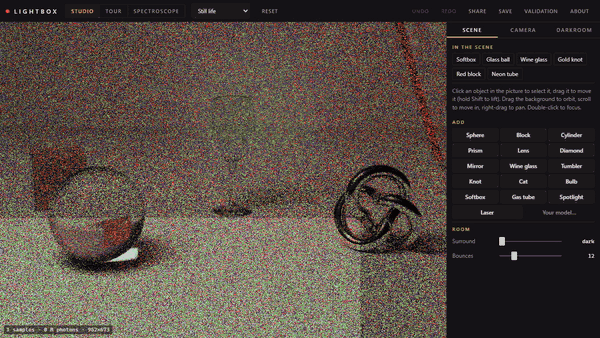
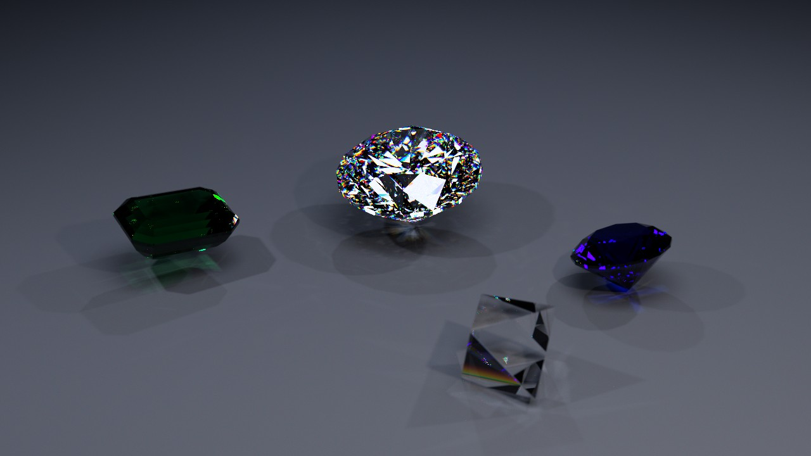
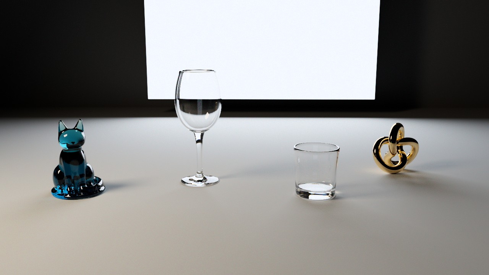
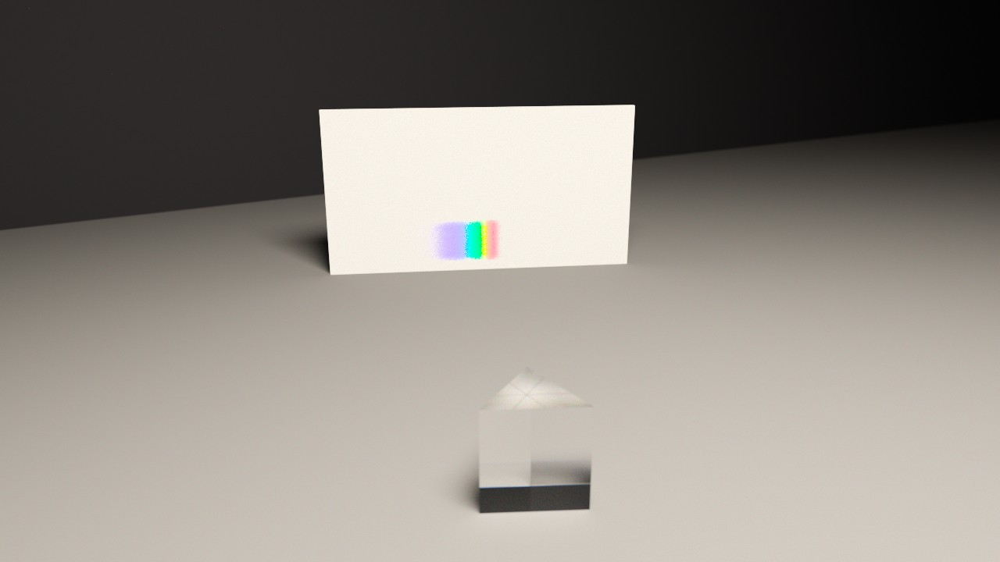
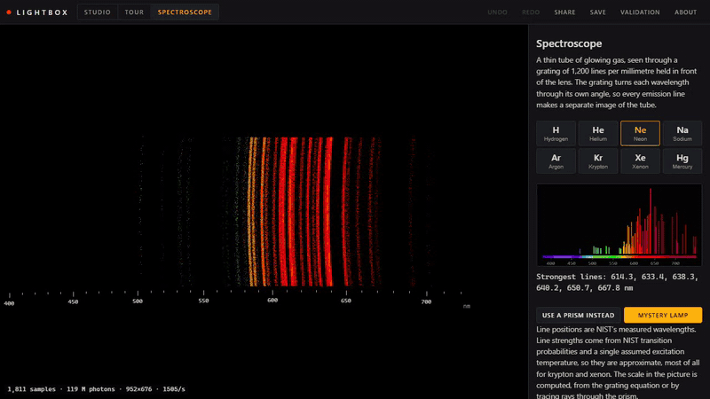
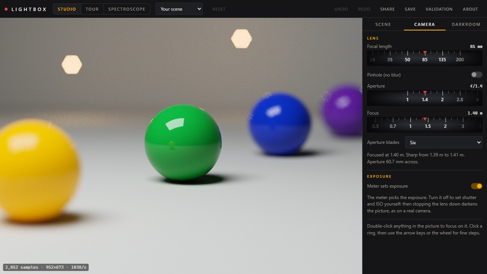
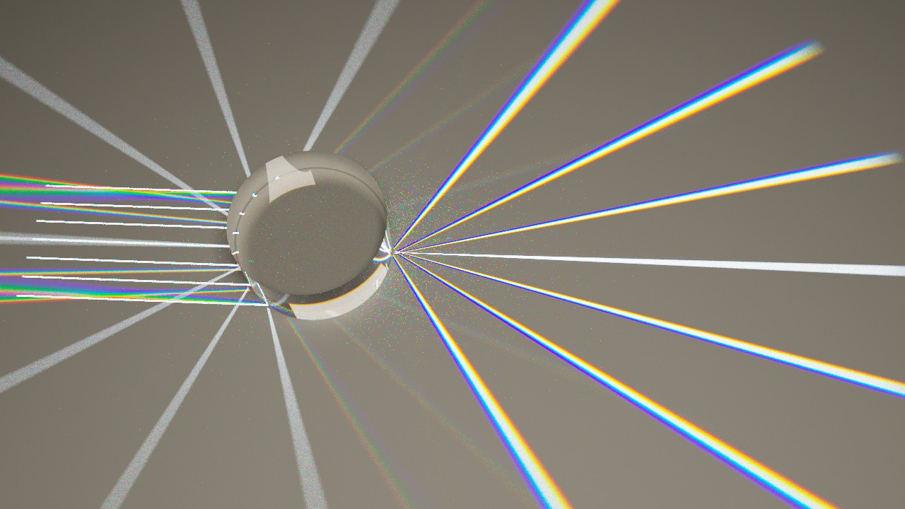
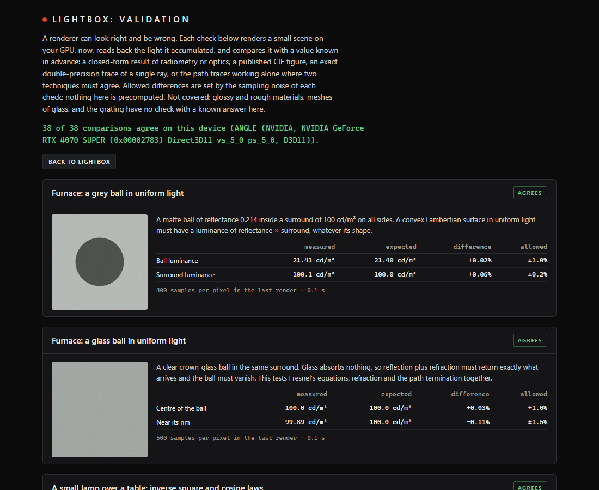

# Lightbox

**A spectral path tracer in your browser. Arrange glass, mirrors, gems and gas tubes, and watch light do what light
does, one wavelength at a time.**



Live: **https://highsierralabs.github.io/End_of_week_challenge/lightbox/** · Validation: [validation.html](https://highsierralabs.github.io/End_of_week_challenge/lightbox/validation.html)

Nothing in Lightbox is drawn. For every pixel it follows one ray of one wavelength backwards from the camera, lets it
reflect, refract and be absorbed the way light is, and records how much light it found; then it does that again. A
few hundred tries make a photograph. Colour is never painted on: it comes from each lamp's spectrum, each material's
response at each wavelength, and the standard observer's colour matching functions. That is why a prism here makes a
spectrum without being told to, a diamond has fire, and six bright paints under a sodium lamp all turn the same
yellow.

It runs on WebGL2, in current Chrome, Edge, Firefox and Safari, on a phone or a desktop. Nothing is precomputed and
nothing leaves the device.

## What you can do

- **Studio.** Click an object to select it and drag it across the table (Shift lifts it). Drag the background to
  orbit, scroll to move in, right-drag to pan. The inspector edits shape, place and material: matte paint, glossy
  lacquer, gold, silver, copper, aluminium, mirror, seven kinds of glass (with their measured dispersion), tinted
  glass, lamps of any colour temperature, gas discharge tubes, lasers, spotlights. Add spheres, blocks, prisms,
  lenses, cut gems, a wine glass, a tumbler, a knot, a cat, or drop in your own GLB or OBJ model. Undo with Ctrl+Z.
- **Camera.** A real lens: focal length, aperture, focus distance, and the number of aperture blades, on rings that
  turn like a lens barrel. Double-click anything to focus on it. Turn the meter off and the shutter and ISO rings
  take over, so stopping down darkens the picture as it would on a camera.
- **Darkroom.** Exposure, white balance, film curve, glare, natural vignetting. Save the picture, or render it
  afresh at up to 3840 × 2160 to a sample count you choose.
- **Tour.** Twelve live scenes, each on one thing light does: soft shadows, colour bleeding, Fresnel reflection,
  refraction, caustics, dispersion, the fire of a diamond, line spectra, a single-wavelength lamp, depth of field,
  chromatic aberration. Every step can be opened in the studio and changed.
- **Spectroscope.** A thin tube of glowing gas (hydrogen, helium, neon, sodium, argon, krypton, xenon or mercury)
  seen through a 1,200 line/mm grating or a flint-glass prism, so that every emission line makes its own image of the
  tube above a wavelength scale. Then a quiz: name the gas from its spectrum alone.
- **Share.** The Share button puts the whole scene in the link.













## How it works

1. **One wavelength per ray.** Every spectrum is a table of 1,024 samples from 380 to 750 nm. A path carries one
   wavelength, looks everything up at it, and adds its result to the pixel through the CIE 1931 colour matching
   functions. Each sweep of the image uses eight wavelengths, drawn where the scene's lamps actually emit and shifted
   from sweep to sweep.
2. **Measured optics.** Glass indices come from Sellmeier formulas (Schott N-BK7, SF10, N-SF11, fused silica,
   diamond, water, sapphire), metals from measured complex indices (Johnson and Christy; McPeak), gas lines from
   NIST's wavelengths and transition probabilities, colour from the CIE's own tables. Sources, licences and every
   transformation are listed in [data-src/SOURCES.md](data-src/SOURCES.md).
3. **Exact shapes.** Spheres, boxes, cylinders, lenses (two spherical faces and a rim), prisms and cut gems (a round
   brilliant is 57 facets and a girdle, as planes) are intersected exactly in the shader. Triangle meshes sit behind
   a bounding volume hierarchy that the shader walks with a small stack.
4. **Three ways of finding light,** because no single one finds all of it:
   - a **path tracer** from the camera, which connects every matte surface to a lamp and weighs that against the
     chance of hitting the lamp anyway;
   - a **photon pass** from the lamps through glass and off mirrors, drawn straight onto the pixels where the
     photons land, for caustics;
   - a **photon map**, gathered by camera paths, for caustics that are themselves seen through glass or in a mirror.

   The three divide the paths of light between them so that each is counted exactly once.
5. **A camera, then a darkroom.** A thin lens with a real aperture gives depth of field; exposure is in photographic
   units; development does white balance, a film curve, glare and the conversion to your display's gamut.
6. **Pacing.** The image is traced in tiles, as many per animation frame as the GPU can do while the page stays
   responsive, so the same code runs on a desktop card and a phone.

The full model, with its approximations, is in [docs/physics.md](docs/physics.md).

## Validation

A renderer can look right and be wrong, so Lightbox comes with a page that measures it:
[validation.html](https://highsierralabs.github.io/End_of_week_challenge/lightbox/validation.html) renders twelve
small scenes on your GPU and compares what the tracer accumulated with values known in advance. On the machine it was
built on (RTX 4070 Super, Chromium, Direct3D 11) all 35 comparisons agree, with the same figures on every run:

| Check | Compared with | Largest difference |
|---|---|---|
| Grey ball in uniform light (furnace test) | reflectance × surround | 0.06% |
| Glass ball in uniform light: must vanish | the surround | 0.11% |
| Small lamp over a table, at three distances | inverse-square and cosine laws | 0.24% |
| Rectangular lamp, at three points | closed-form irradiance of a rectangle | 1.6% |
| Reflection in black glass, 15° to 85° | Fresnel's equations over the lamp's spectrum | 0.65% |
| Laser beams through a prism, 450 / 550 / 650 nm | exact trace with the Sellmeier index | 0.10 mm at 1 m |
| Parallel beams through a thick lens | exact trace through both faces | 0.010 mm |
| Photon pass on, against the path tracer alone | the same total light | 0.13% |
| A caustic seen in a mirror (photon map) | the path tracer alone | 0.42% |
| Chromaticity of D65, illuminant A, neon | published CIE values; the direct integral | 0.0006 in x, y |
| Triangle mesh ball against the exact sphere | the exact sphere | 0.07% |
| Blur disc of an out-of-focus point | thin-lens formula | 2.8% |

The page earned its keep during the build. Its first run showed light from a small, distant lamp reading 0.4% low at
1 m and 2.3% low at 2 m. The cause was a shadow ray whose length came from a cancelling quadratic: near the lamp's
edge the ray overshot and was stopped by the lamp itself. Shadow rays now ignore the lamp they are aimed at, and the
figures above are from after that fix.



## What was verified, and what was not

Verified on the build machine (Windows, RTX 4070 Super, headless and headed Chromium):

- `npm run check`: typecheck, lint and 130 unit tests (spectra and colour against published values, glass formulas
  against catalogue indices, the brilliant cut's convexity, lens and polytope intersections, the mesh BVH against
  brute force, share-link sanitising, every built-in scene packing to finite data and surviving a link round trip,
  prisms standing at minimum deviation).
- `npm run smoke`: the production build served from a subfolder and driven like a visitor: boot, select, drag, undo,
  orbit, focus, the inspector, a lens ring, all seven scenes, all twelve tour steps, sixteen spectroscope views and
  the quiz, a share-link round trip, save and export, a dropped model, the validation page, a phone-sized touch
  viewport, then a boot on ANGLE's Vulkan backend (a second shader compiler) and on the software renderer.

Not verified:

- **Real phones and tablets.** The phone layout and touch handling were tested only in an emulated viewport on a
  desktop GPU. The software renderer shows the app stays alive and adapts on a very slow device, but that is not a
  phone's GPU or its shader compiler.
- **Safari and Firefox.** Only Chromium was run.
- **OpenGL drivers.** ANGLE's OpenGL backend could not be tested: in headless Chromium on the build machine it loses
  every WebGL2 context after about two seconds, even with a one-line shader.

## Limits

- No fog: beams are invisible in the air and show only where they land.
- No polarisation, interference or diffraction (the grating is an idealised element: right angles, invented
  efficiencies).
- Glass cannot overlap glass, so no water in the wine glass.
- Gas line *wavelengths* are NIST's; line *strengths* come from a one-temperature excitation model and are
  approximate, most of all for krypton and xenon.
- Caustics seen through glass or in a mirror come from a photon map: slightly soft at first, sharpening as the
  picture refines.
- A colour picked on screen becomes one of the many spectra that have that colour.

## Run it

```bash
npm ci
npm run dev        # http://127.0.0.1:5196
npm run check      # typecheck, lint, unit tests
npm run build      # static site in dist/
npm run smoke      # the built site in GPU Chromium, as a visitor meets it
node scripts/validate.mjs   # prints every validation comparison (needs the dev server)
```

`scripts/build-data.mjs` regenerates `src/data/optics.ts` from `data-src/`; `blender/make_models.py` rebuilds the
four models headless in Blender 5.2; `scripts/clip.mjs` records the pictures on this page.

## Layout

```
data-src/        fetched reference data and SOURCES.md
blender/         the script that builds the models in public/models
src/core/        pure, tested: spectra, scene model, shapes, meshes, packing, scenes, share links
src/gpu/         the tracer: shaders, engine, display chain
src/app/         the studio, tour and spectroscope
src/validation/  the validation page
scripts/         data build, smoke test, validation runner, screenshots
tests/unit/      vitest
```

## Data and licences

The code is MIT. The reference data it ships are not: the CIE tables are CC BY-SA 4.0, the atomic line data are from
the NIST Atomic Spectra Database, and the glass and metal data are from the refractiveindex.info database (CC0). See
[THIRD-PARTY-NOTICES.md](../THIRD-PARTY-NOTICES.md) and [data-src/SOURCES.md](data-src/SOURCES.md).
