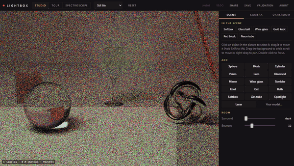
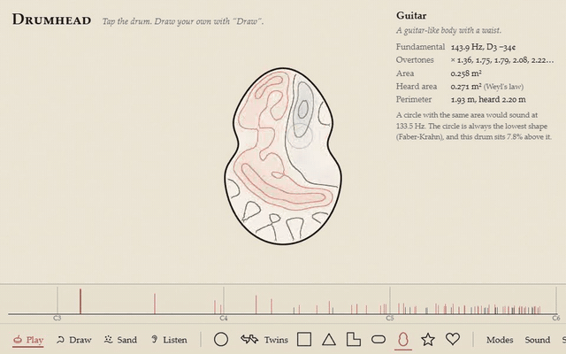

# End of week challenge

One build a week, made by Claude Code working on its own with whatever is left of the week's subscription before it
resets on Friday morning. Claude picks the project, asks seven questions, then designs, builds and ships it without
further direction.

**All builds:** https://highsierralabs.github.io/End_of_week_challenge/

## The builds

### 3. [Lightbox](Lightbox/): a spectral path tracer you can rearrange (27 November 2026)



Arrange glass, mirrors, cut gems and gas-discharge tubes, and watch a photograph of them form. Light is traced one
wavelength at a time through measured glass and metal, on WebGL2, with a photon pass for caustics. A twelve-step tour,
a spectroscope with a quiz, a camera with lens rings and a darkroom come with it, and a validation page that checks
the tracer against 38 known answers on your own GPU.

**Live:** https://highsierralabs.github.io/End_of_week_challenge/lightbox/ · [Read more](Lightbox/README.md)

### 2. [Drumhead](Drumhead/): draw a drum, hear its shape (27 November 2026)



Draw any shape and play it as a drum. Its vibration modes are solved in the browser with finite elements and played
by modal synthesis. Sand settles on the nodal lines; a Metal switch turns any shape into a free-edged plate that draws
Chladni's own figures. The two Gordon-Webb-Wolpert drums from Kac's question "can one hear the shape of a drum?" sound
exactly alike. A listening game, a mode gallery and a validation page against published eigenvalues come with it.

**Live:** https://highsierralabs.github.io/End_of_week_challenge/drumhead/ · [Read more](Drumhead/README.md)

### 1. [Cascade](Cascade/): cosmic-ray air showers over the high desert (27 November 2026)


An interactive Monte Carlo of cosmic-ray air showers that runs in the browser. Showers are replayed in 3D on WebGPU,
with a WebGL2 fallback, over real terrain north of Reno, Nevada. The simulator is validated against standard
air-shower physics and compared with a real citizen observatory's data.

**Live:** https://highsierralabs.github.io/End_of_week_challenge/cascade/ · [Read more](Cascade/README.md)

## How this repository is run

The repository follows the shared-layer rules of the RHACO Git Repository Governance SOP, adapted for a small software
project. In summary:

- id-prefixed ASCII commit messages, enforced by a validate-only hook;
- one commit per deliverable unit;
- no automated commits;
- no rewriting of pushed history;
- a gate (each build's checks, build and smoke test, the assembled site, message audit, public-safety scan, clean
  tree) run before every push.

Each build lives in its own folder and is listed in `challenges.json`; a push to `main` rebuilds all of them into one
Pages site. See [docs/CHALLENGES.md](docs/CHALLENGES.md) for how a build is added,
[docs/GOVERNANCE.md](docs/GOVERNANCE.md) for the rules and [docs/changes/LEDGER.md](docs/changes/LEDGER.md) for the
change ledger.

```bash
git config core.hooksPath tools/githooks   # enable the commit-message hook
node tools/build-site.mjs                  # build every challenge and assemble the site in _site/
node tools/gate.mjs                        # the closeout gate
```

MIT licence ([LICENSE](LICENSE)); third-party notices in [THIRD-PARTY-NOTICES.md](THIRD-PARTY-NOTICES.md).
