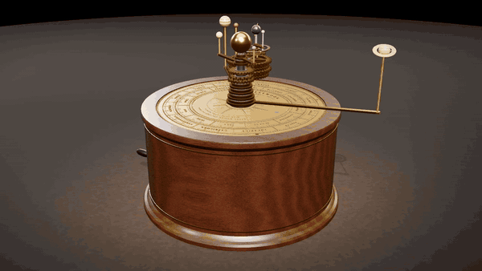
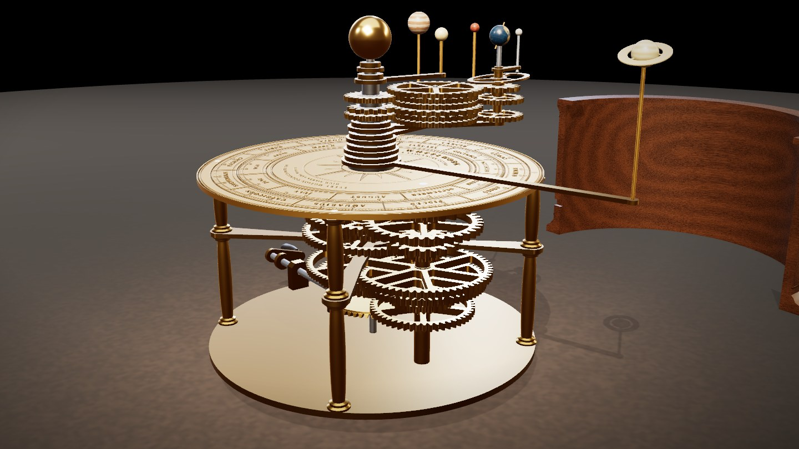
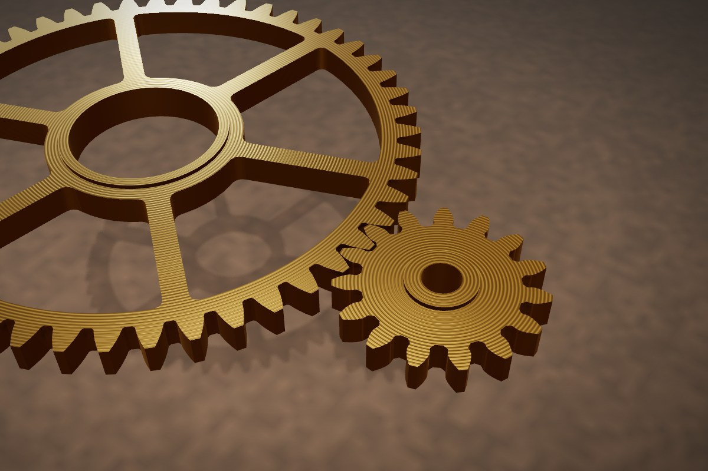
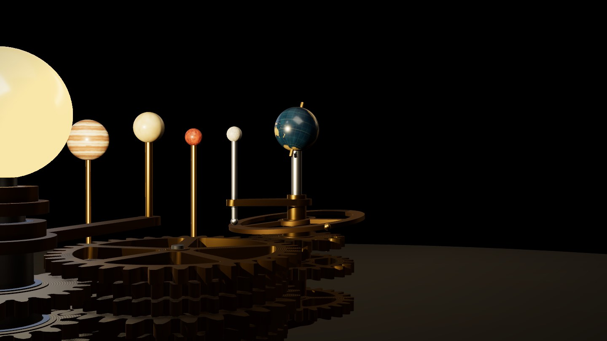
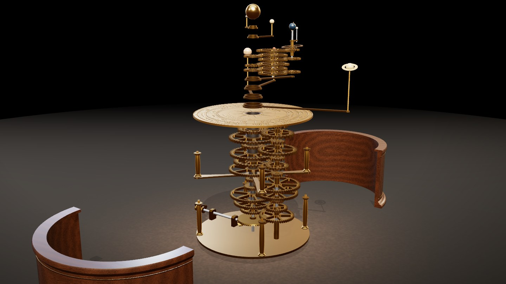
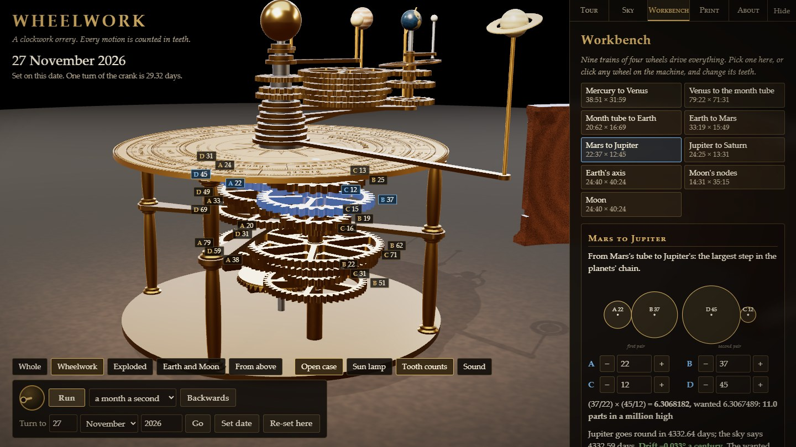
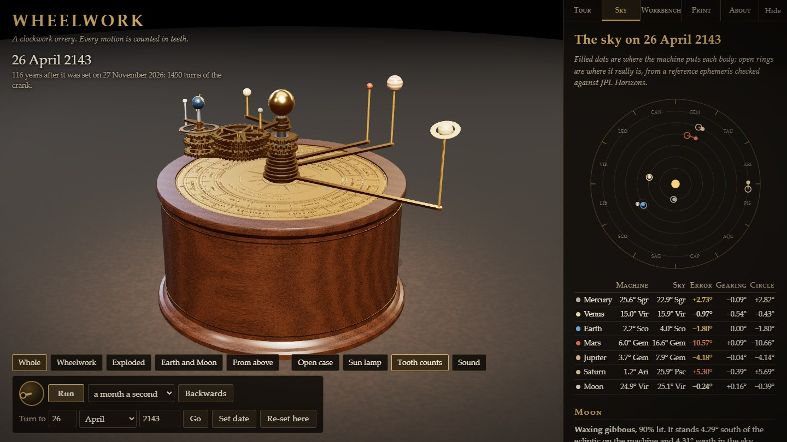
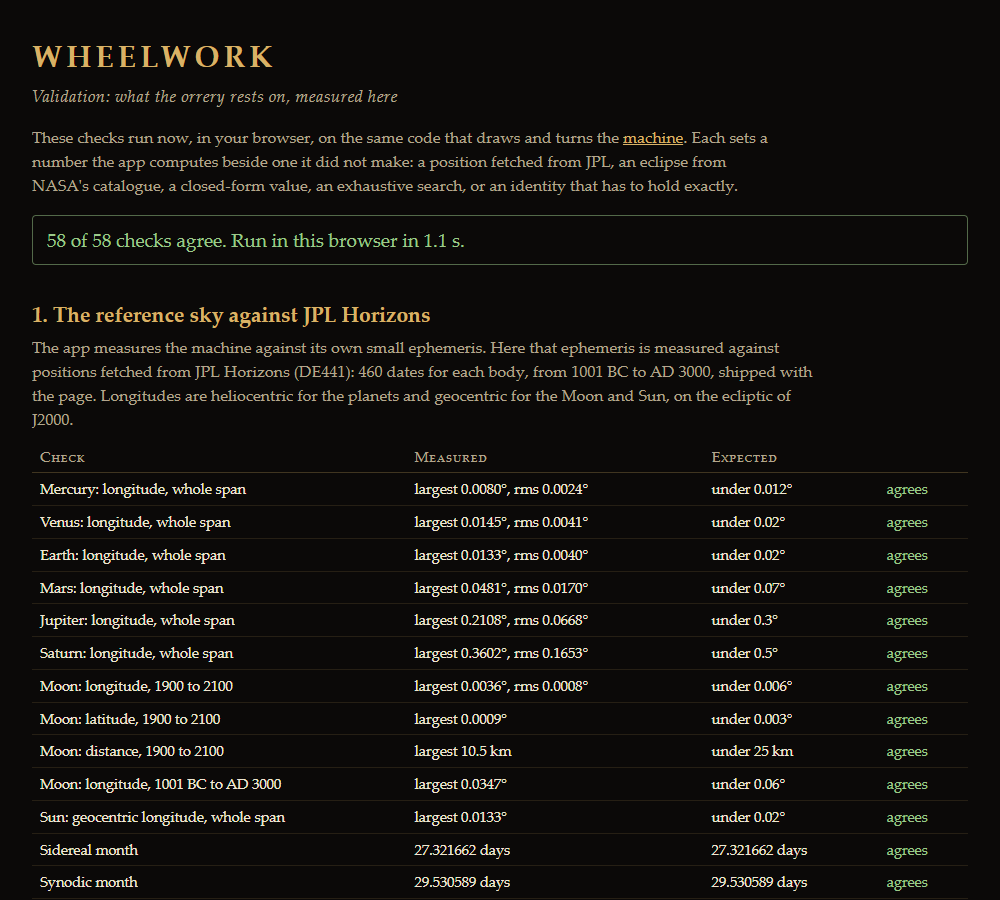

# Wheelwork

**A brass clockwork orrery in your browser. Count its teeth, change them, check it against the sky, and print it.**



Live: **https://highsierralabs.github.io/End_of_week_challenge/wheelwork/** · Validation: [validation.html](https://highsierralabs.github.io/End_of_week_challenge/wheelwork/validation.html)

An orrery is a model of the solar system worked by gears. This one carries Mercury to Saturn round the Sun and the
Moon round the Earth, with the Moon's orbit tipped and its nodes creeping backwards, and the Earth's axis leaning the
same way all year.

It exists as a list of tooth counts. From those the app works out every wheel's size and place, draws the machine,
turns it, measures it against the real sky, and writes it out as files for a 3D printer. Nothing on screen is animated
by astronomy: every motion is one wheel pushing another, at a rate that is an exact product of tooth counts. The sky
enters once, when the arms are set on a date.

It runs on WebGL2 in current Chrome, Edge, Firefox and Safari, on a desktop or a phone. Nothing leaves the device.

## What you can do

- **Turn the crank.** Drag the handle on the side of the case, or the dial, or press Run and choose anything from a
  day to a century a second. One turn is 29.3 days. Turn to any date from 3000 BC to AD 3000.
- **Open it.** The walnut case parts to show the wheelwork, with each wheel's tooth count written beside it; another
  view lifts every level apart. Hover any wheel to see its tooth size and how long it takes to turn once. Click it to
  open its train on the workbench.
- **Follow the Earth and Moon.** Put out the room lights and light the Sun: the Earth and Moon are lit as they are,
  and the phases follow. The Moon rides up and down on an inclined ring, and the machine says when it is an eclipse
  season.
- **Read it against the sky.** The Sky panel sets each body's place on the machine beside its true place, and splits
  the difference in two: what the gearing has lost since the machine was set, and what steady circles cannot follow.
  It also looks out from the machine's Earth: where each planet stands in the zodiac, and whether it is running
  backwards, on the machine and in the sky.
- **Change the gearing.** Nine trains of four wheels drive everything. Add or take away teeth and the machine is
  rebuilt at once. Ask the solver for the trains closest to a ratio, or for a whole new machine with no wheel over,
  say, 40 teeth, and see what a century does to it.
- **Take the tour.** Thirteen stops, from the crank to continued fractions to eclipse seasons. The figures in its text
  are read from the machine as it stands.
- **Print it.** The same solids as a zip of 70 STL files with a parts list and assembly notes. Checked by computation;
  not printed (see below).





| | |
|---|---|
|  |  |
|  |  |

## The machine

There are 38 toothed wheels: 36 spur wheels in nine trains, and a bevel pair for the crank.

**Two axes.** The planets' arms are carried on a nest of tubes, one inside another, on the central axis. Beside it
stands a single post, 54 mm away. On the post turn six free *clusters*, each a pair of wheels made as one piece. A
wheel on one tube drives a cluster and the cluster drives the next tube, so every train has the same shape: wheel A
meshes B, C (on the same cluster as B) meshes D, and the ratio is (B/A) × (D/C). Because the distance between the axes
is fixed, the tooth size of each pair follows from its tooth counts: more teeth means finer teeth.

**The chain** runs Mercury, Venus, the *month tube*, Earth, Mars, Jupiter, Saturn. The month tube turns once a sidereal
month. The crank's bevel pinion drives a bevel wheel on the bottom of Mercury's tube.

**The tellurion.** The Earth's arm carries three more trains out to the Earth. One hands the month tube's turning to
the Moon's arm. The other two start from wheels on a tube that does not turn, held by a bridge inside the case:
rolling round a still wheel is how the arm gets a motion that is fixed, or nearly fixed, against the stars. A train of
exactly one to one keeps the Earth's axis pointing the same way. A train a little off one to one turns the inclined
ring under the Moon backwards, once in 18.6 years.

As designed, with no wheel over 96 teeth and no teeth finer than module 1.0:

| Train | A:B × C:D | Body | Drift in a century |
|---|---|---|---:|
| Mercury to Venus | 38:51 × 31:59 | Mercury | −0.08° |
| Venus to the month tube | 79:22 × 71:31 | Venus | −0.46° |
| Month tube to Earth | 20:62 × 16:69 | Moon | +0.13° |
| Earth to Mars | 33:19 × 15:49 | Mars | +0.08° |
| Mars to Jupiter | 22:37 × 12:45 | Jupiter | −0.03° |
| Jupiter to Saturn | 24:25 × 13:31 | Saturn | −0.34° |
| Moon's nodes | 14:31 × 35:15 | the nodes | −0.08° |
| Earth's axis, Moon | 24:40 × 40:24 | exactly one to one | none |

The Earth's arm is the calendar: one turn of it is one sidereal year by definition, and the other bodies are judged
against it. The designer settles the trains outwards from the Earth, so that each one's target absorbs the error of
the trains between it and the Earth, and for each takes the coarsest teeth that hold the drift allowed (half a degree
a century here).

[docs/mechanism.md](docs/mechanism.md) has the dimensions, the levels and the design rules.

## What it shows about orreries

- **Gearing is not the problem.** Four modest wheels per train hold every planet's mean place to under half a degree
  in a century. Huygens, with one pair per planet, needed 206 teeth against 7 for Saturn.
- **Circles are.** The arms turn evenly; planets do not. The machine is wrong by up to 23.9° for Mercury and 10.7° for
  Mars, swinging back and forth each orbit (measured on the validation page).
- **A geared Moon predicts eclipses rather well.** Set today and run back over 1901 to 2100, the machine's own rule
  (a new or full Moon close enough to a node) calls 771 eclipses, of which 708 happened, and it catches 708 of the 740
  solar and umbral lunar eclipses in NASA's catalogue.

## Validation

[validation.html](https://highsierralabs.github.io/End_of_week_challenge/wheelwork/validation.html) runs 58 checks in
your own browser, on the code that draws and turns the machine. Each sets a number the app computes beside one it did
not make.



| What | Against | Result here |
|---|---|---|
| The reference planets, 1001 BC to AD 3000 | 460 positions per body fetched from JPL Horizons (DE441) | largest error 0.008° (Mercury) to 0.36° (Saturn) |
| The reference Moon, 1900 to 2100 | JPL Horizons | longitude within 0.0036°, latitude within 0.0009° |
| New and full Moons | NASA's 909 catalogue eclipses of 1901 to 2100 | every one within 0.33 hours of a computed new or full Moon |
| Tooth form | closed forms for tooth thickness, base radius, contact ratio | agree to the digits shown |
| All 18 meshing pairs, swept through a tooth pitch | zero overlap; gap equal to the backlash cut | 0 overlap, 0.113 mm gap, lowest contact ratio 1.24 |
| Kinematics | identities in exact fractions; every mesh in step at six crank positions | off by at most 2 × 10⁻¹¹ of a tooth |
| The train solver | brute force over 620,844 trains | the same train |
| The machine's eclipse seasons and calls | NASA's catalogue | 899 of 909 inside a season; calls as above |
| Every solid, screen model and print kit | closed, consistently wound surface | 101 of 101 and 70 of 70 |

## What was verified, and what was not

Verified, by running it:

- `npm run check`: typecheck, lint and 322 unit tests. They include the reference astronomy against the Horizons rows
  and the eclipse catalogue, a rack cutter rolled independently past every generated tooth outline, sweeps of 16 gear
  pairs, the solver against brute force, and every part and kit piece as a closed solid.
- `npm run smoke`: the production build served from a subfolder in GPU Chromium, 52 checks: boot, the crank dragged in
  the scene and on the dial, running, turning to AD 2100 and 501 BC, re-setting, every view, the lamp, hovering and
  clicking a wheel, editing a train, the solver, a 40-tooth redesign, a machine carried in a link, the sky panel, all
  thirteen tour stops, running to the next eclipse, the kit checked and downloaded (2.8 MB), the validation page, a
  phone viewport with touch, and the software renderer.
- An outside check of the solids: `scripts/blender-interference.py` loads the assembled machine into headless Blender
  5.2 at three crank positions. No part has an open edge, and in 835 pairs of neighbouring parts none belonging to
  different moving bodies cut through each other. With the wheels deliberately left out of phase the same script
  reports all 18 meshes, so it can fail. See [docs/print-check.md](docs/print-check.md).
- A visitor-style pass by a separate agent driving the built site in Chromium at desktop, tablet and phone sizes. It
  found no errors in the console and one serious fault: on phones narrower than 400 px, and in desktop windows 821 to
  980 px wide, the transport bar lay over the view buttons. That and its fourteen smaller findings (the space bar
  stolen from focused buttons, no way to turn to a date on a phone, a designer that claimed success when its limits
  could not hold the drift asked, tooltips that never showed by touch, Saturn cut off in the view from above) are
  fixed.
- Two independent code reviews by Codex (OpenAI's coding agent, through its Claude Code plugin). The first found ten
  issues, among them that rigid clusters were being phased as if their two wheels were separate, that the solver
  could return the wrong one of many equal trains, and that eclipses were judged a few hours off the exact new Moon.
  The second read the solids as a kit to be assembled and found fourteen: press fits drawn with clearance, pillar
  pins with no sockets to enter, a polar axis that crossed the socket of the Earth's shaft, a ring with nothing
  holding it to Saturn, balls with no face to print on, and two validation rows that claimed more than they
  measured. All are fixed, most with tests.

Not verified:

- **The print kit has not been printed or assembled.** Fits are nominal: fixed fits are drawn size for size, on the
  expectation that a printed hole comes out small, and running fits have 0.2 to 0.25 mm on radius. Small parts on
  the Earth's arm are at the limit of what a filament printer makes at scale 1, long thin tubes printed upright will
  not be straight, two pieces (the Earth, and the node sleeve with its tipped ring) have no flat face and need
  supports, and nobody has checked that hands and tools can reach where the assembly notes say to put things.
- The bevel pair uses Tredgold's approximation. It was checked by sampling points in 3D in the unit tests, not
  against a spherical involute, and it is not in the kit's table of swept pairs, which covers the 18 spur pairs.
- Phones were tested as a 390 × 844 touch viewport in desktop Chromium, not on a device. Firefox and WebKit were run
  as Playwright's builds on Windows (`scripts/browsers.mjs`: boot, drawing, running, the case, a rebuild, the lamp and
  the validation page all pass); Safari itself was not.
- The sound was checked to start; nobody listened to it.
- Frame rate was measured only on the build machine: about 130 frames a second at 1920 × 1080 in headless Chromium
  on an RTX 4070 Super with vsync off, and 92 with the Sun lamp, which redraws a cube of shadow maps every frame.
  Nothing slower was tried except the software renderer, which boots and draws.

## Limits

- Uniform circular motion, as nearly all orreries have. No eccentrics, no pin and slot.
- Orbits are spaced so the arms clear one another, and the balls are sized to be seen. Nothing above the deck is to
  scale.
- The Earth does not spin, and Saturn's ring turns with its arm.
- The eclipse rule is a limit on the Moon's latitude at the machine's own new or full Moon. The lamp throws shadows
  far more often than that, because the model's Earth and Moon are huge for their distance.
- The calendar ring is engraved for 2026. The machine keeps sidereal years, so against the seasons the ring is a day
  out after about 70 years.
- The reference sky is good to hundredths of a degree for the inner planets and the Moon and a few tenths for Jupiter
  and Saturn: far finer than the machine's errors, not an ephemeris to navigate by.

## Run it

```bash
cd Wheelwork
npm ci                 # Node 24.14.1 or later in the 24 line
npm run dev            # http://127.0.0.1:5206
npm run check          # typecheck, lint, 322 unit tests
npm run build          # dist/
npm run smoke          # the built site in GPU Chromium, from a subfolder
node scripts/browsers.mjs                       # the same site in Firefox and WebKit (needs npx vite preview)
node scripts/validate.mjs                       # every validation row, as text (needs the dev server)
node scripts/fetch-data.mjs --offline           # regenerate the reference tables from data-src/
```

## Layout

```
src/core/astro     reference astronomy, J2000 frame (pure, no DOM)
src/core/gears     involute teeth, mesh sweeps, the bevel pair
src/core/mesh      extrusions, turned solids, closed-surface check, STL
src/core/train     exact fractions, continued fractions, the four-wheel solver
src/core/machine   dimensions, tooth-count spec and designer, layout and rules, kinematics, parts, sky readings, print kit
src/data           generated tables: Horizons rows, eclipse catalogue, land mask
src/app            the three.js stage, panels, tour, sound, zip export
src/validation     the validation page
data-src           the fetched reference data as retrieved, with SOURCES.md
scripts            smoke test, recorder, data fetchers, the Blender check
```

## Data and licences

The code is MIT. Wheelwork ships three.js, fflate and earcut, and reference data from JPL, NASA, ERFA and Natural
Earth; see [THIRD-PARTY-NOTICES.md](../THIRD-PARTY-NOTICES.md) and [data-src/SOURCES.md](data-src/SOURCES.md).

## Build cost

What the build took, from Claude Code's own records of the session: its usage meter, and the transcripts of the main
session and its subagents, summed by `Lightbox/scripts/build-cost.mjs`. The run started on 27 November 2026 at 18:56
Pacific. The figures stop at 21:17, when this section was written: the trial gate had passed, and the release commit,
the final gate, the push and the check of the live site were still to come.

| | |
|---|---|
| Elapsed, wall clock | 2 h 20 min |
| Model time, summed over all agents (some ran in parallel) | 2 h 34 min |
| Models | Claude Fable 5.2 (`claude-fable-5-2`) for the main session and three subagents; Claude Sonnet 5.5 for the two thin subagents that handed the reviews to Codex |
| API responses | 322 |
| Output tokens | 953,963 |
| Input tokens: uncached / written to cache / read from cache | 648 / 1,808,025 / 122,655,264 |
| Cost at API prices, as metered by Claude Code | $84.16 |
| The account's weekly meter (all models) during the run | from 10% to 17% |

| Agent | API responses | Output | Cache writes | Cache reads | First to last response |
|---|---:|---:|---:|---:|---:|
| Main session (design, machine, app, fixes, release) | 194 | 540,133 | 824,682 | 101,593,276 | 140 min |
| Subagent: reference astronomy and fetched data | 39 | 118,137 | 227,499 | 5,411,761 | 20 min |
| Subagent: involute and bevel gear geometry | 34 | 176,870 | 295,442 | 6,342,709 | 32 min |
| Subagent: visitor QA in the browser | 47 | 102,457 | 316,052 | 9,203,291 | 30 min |
| Subagent: first Codex review (hand-off only) | 4 | 8,012 | 72,870 | 52,073 | 10 min |
| Subagent: second Codex review (hand-off only) | 4 | 8,354 | 71,480 | 52,154 | 12 min |

How to read these:

- **The dollar figure is an estimate, not a bill.** The run was on a subscription. $84.16 is what Claude Code's meter
  says the same calls would cost at API prices.
- **The two code reviews are not in these figures.** They were done by Codex on its own account; only the small
  Claude subagents that passed the brief over and brought the report back are counted here. What Codex spent was not
  measured.
- **Almost all input is cache reads.** Every API call re-reads the conversation so far, so 194 calls in the main
  session read 102 million tokens from cache while writing under a million new ones.
- **The weekly meter is the account's, not this session's.** The seven points are an upper bound on this build's
  share. The operator set a ceiling of 30% for the run; it finished at about 17%.
- **Not counted:** the build machine's own work (rendering on the GPU, test and smoke runs, headless Blender, the
  Firefox and WebKit downloads), and the GitHub Actions run that deploys the site.

The same hours by commit time: core and app at 20:02, the validation page and smoke test at 20:10, the first review's
fixes at 20:18, sound and the recorder at 20:24, tooth tags, the view from the Earth and the second review's fixes at
20:44, the visitor pass's fixes at 21:09.
